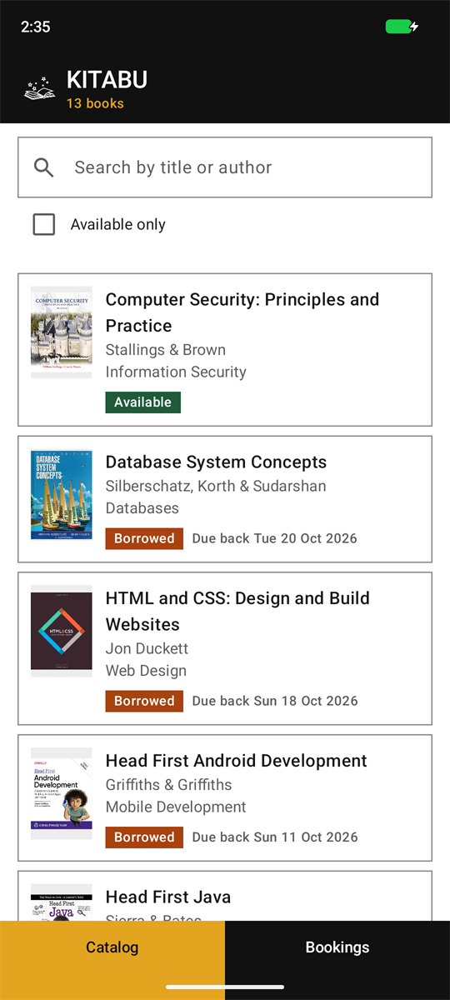
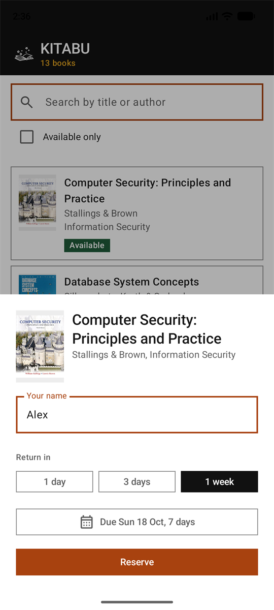
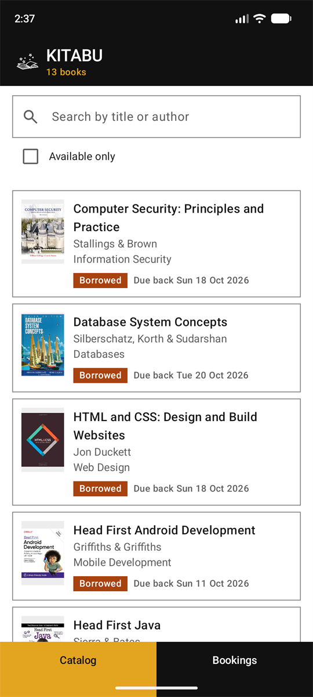
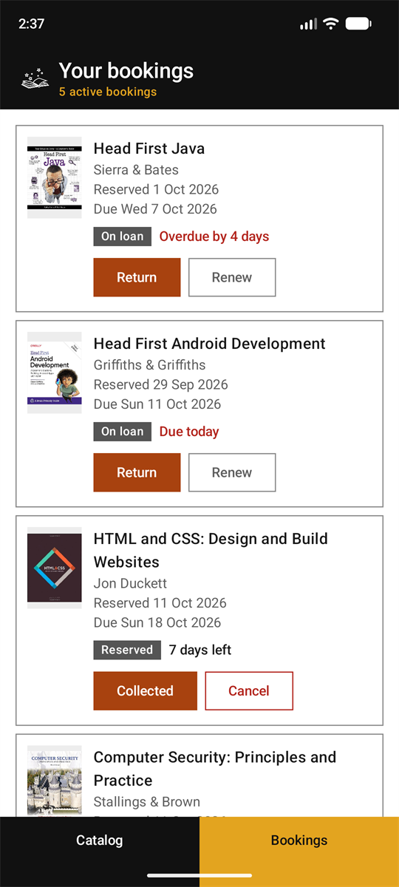
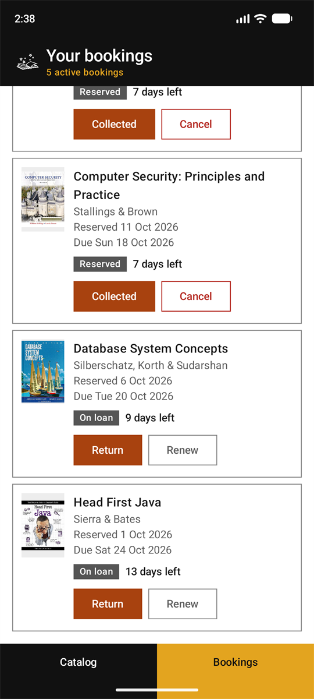
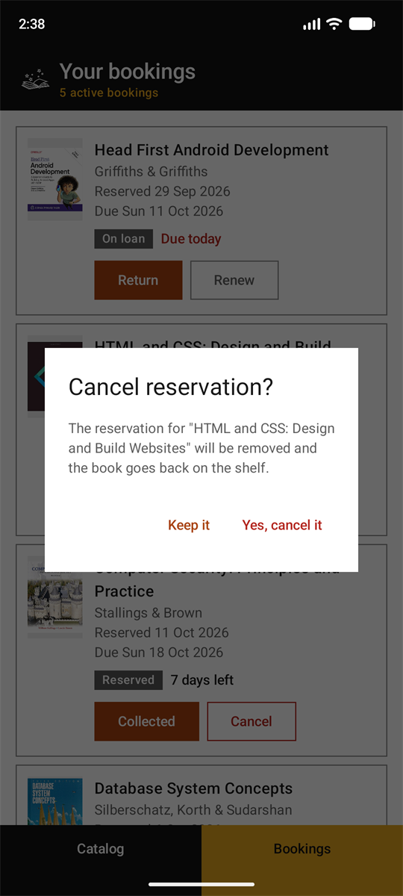

# Kitabu

Kitabu is an Android app for booking books out of a library, written in Kotlin with Jetpack Compose and Room. Everything is stored on the phone and there are no accounts.

## What it does

The catalog lists every book with its cover, title, author, category and availability. You can search by title or author, clear the search with one tap, and tick "Available only" to hide books that are out. Borrowed books show the date they are due back. Tapping an available book opens the reserve sheet. You type your name and choose a return date with the 1 day, 3 days and 1 week buttons or the date picker. The sheet shows the loan length next to the date, for example "Due Sun 18 Oct, 7 days". Reserving is refused with a message if the name is blank or the return date is missing or not after today.

The Bookings tab lists every active booking with its cover, title, author, reserved date, due date and days left. Overdue bookings and ones due today are in red. A new booking is marked Reserved and can be collected or cancelled, and cancelling asks for confirmation. A collected booking is marked On loan and can be returned or renewed with the date picker. A renewal has to be later than both the current due date and today. The header on both screens shows a count, and each action shows a confirmation message.

## Running it

Open the project in Android Studio and run it on an emulator or a phone running Android 8.0 or newer.

## Screenshots

| Browsing the catalog | Reserving a book | The book reserved |
| --- | --- | --- |
|  |  |  |

| Your bookings | Renewing a booking | Cancelling a reservation |
| --- | --- | --- |
|  |  |  |

## How it is put together

The app is split into layers. The screens are written with Jetpack Compose and only display data. The ViewModel holds the data the screens use and handles taps. It asks the repository for data and the repository calls the DAOs. The DAOs hold the SQL queries and Room runs them against a SQLite database on the phone. Results come back as flows, so the screens update when the data changes.

The code is in four packages under com.durelljardim.kitabu: ui for the screens and ViewModel, data for the tables, DAOs, database and repository, domain for the booking-with-book model and the date helpers, and di for the classes that create the database and repository. There are two tables. books has the title, author, category and availability. bookings has the borrower's name, the booked date, the due date and a status of PENDING, ACTIVE or RETURNED, and each booking points at its book. Reserving, cancelling and returning change both tables and each runs as one transaction.

## Credits

The cover images come from Open Library and the icons are Material Symbols.
